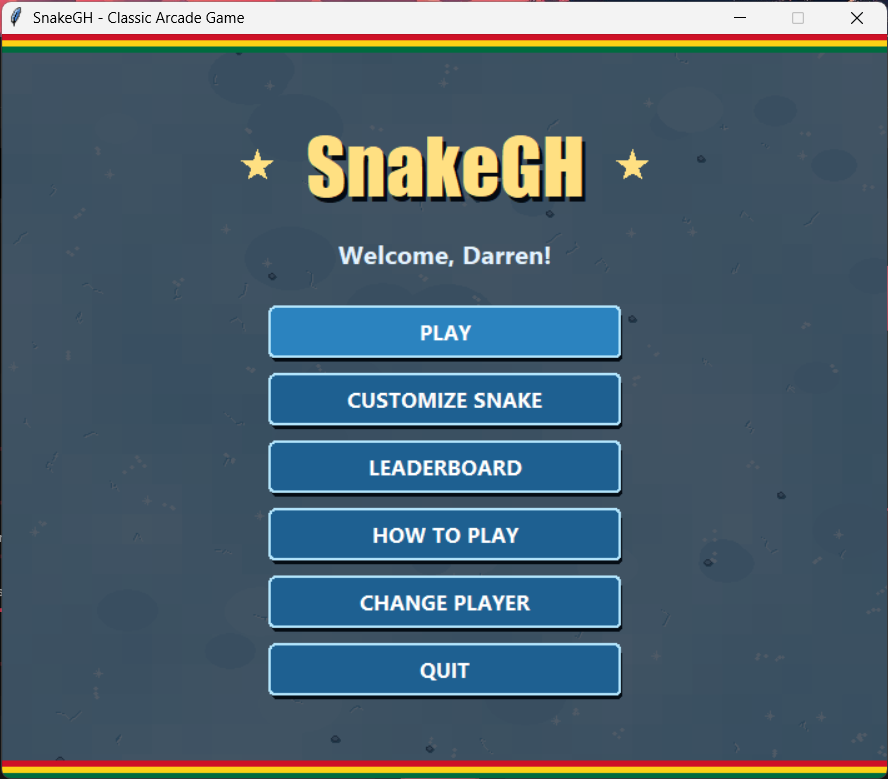

# SnakeGH

A Snake game for one or two players, built with Python and Tkinter. Made for Lab 2 (Python, Level 200).



## Features

- Player registration and a saved leaderboard (solo Top 10 and two-player match wins)
- One or two players on the same keyboard (best of 3 rounds)
- Solid walls or wrap-around walls, with Easy, Normal and Hard difficulty
- The game gets harder as you level up: faster snake and more obstacles
- Four detailed maps: Baobab Savanna, Emerald Canopy, Gold Coast Dunes and Frostbite Lake
- Snake customiser: colours, patterns, hats, tail items and trails
- Power-ups (shield, double points, slow motion, shrink), combo scoring and a golden mango bonus
- Sound effects, particle effects and screen shake

## Requirements

- Python 3.8 or newer
- Tkinter (included with Python on Windows and macOS; on Linux run `sudo apt install python3-tk`)

No other packages are needed.

## Run

```
python snakegh.py
```

## Controls

| Action | Keys |
| --- | --- |
| Player 1 | W A S D |
| Player 2 | Arrow keys |
| One-player mode | W A S D or arrow keys |
| Pause | P or Esc |
| Mute | M |
| Continue after a round | Space |

## Notes

- Scores and snake choices are saved next to the game in `snake_leaderboard.json`, so the leaderboard is shared only between players on the same computer.
- Sound uses the system audio. It works on Windows, macOS, and Linux with `paplay` or `aplay` installed.

## Author

Darren Yaw Boateng Frempong
